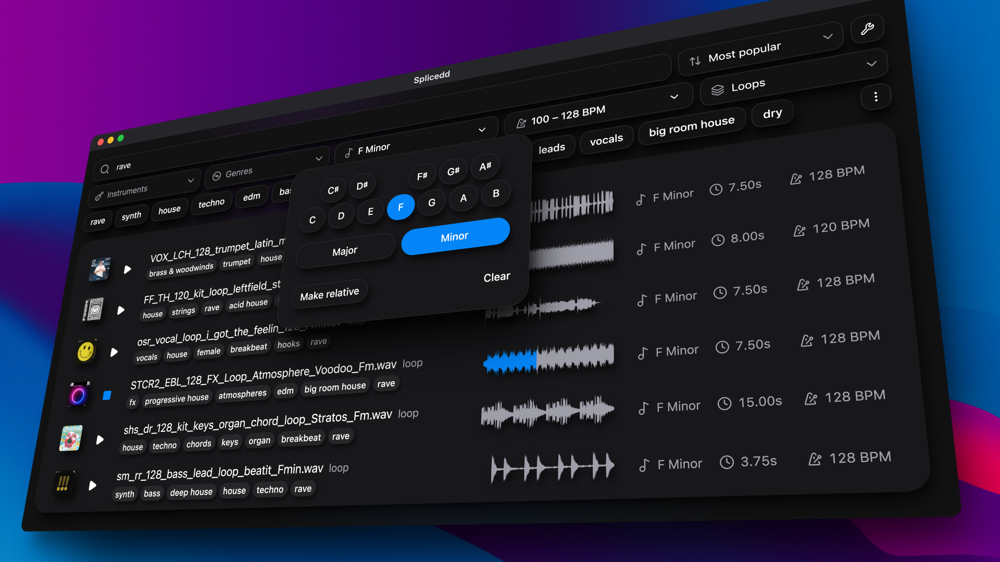

#  splicedd
**Splicedd** is an alternative frontend for the popular [Splice](https://splice.com/features/sounds) sample library. It does not require any kind of authentication, and contains all of the most important features of the regular desktop app (including drag-and-drop).

  <a href="https://github.com/ascpixi/splicedd/releases/"><code>click here to download the latest release!</code></a>
    
  

Basic demo  | Drum loop demo 
------------|---------------
<video src="https://github.com/ascpixi/splicedd/assets/44982772/4406e3a2-1361-4198-baf9-cca5b4fb62af"> | <video src="https://github.com/ascpixi/splicedd/assets/44982772/02dda4ce-d61c-4240-8759-bbd18c31de24">

## macOS
Splicedd isn't notarized by Apple, so macOS will block it the first time you open it. To allow it, either:
- open **System Settings → Privacy & Security**, scroll down and click **Open Anyway** next to the message about Splicedd, or
- run `xattr -dr com.apple.quarantine /Applications/Splicedd.app` in the Terminal.

You only need to do this once.

## Reporting issues
Splicedd keeps logs that help with tracking down problems. To include them in a [bug report](https://github.com/ascpixi/splicedd/issues/new):
1. turn on **Developer mode** in the settings,
2. reproduce the problem,
3. click **View logs** in the settings, then **Open folder**, and attach `splicedd.log`. If you've restarted Splicedd in the meantime (e.g. because it crashed), attach the most recent `splicedd_<date>.log` too.

The logs include your searches, sample names, and folder paths (with your home folder replaced by `~`).
